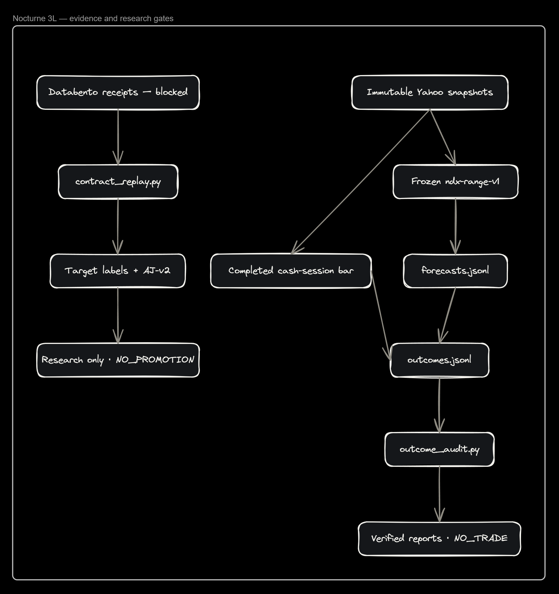
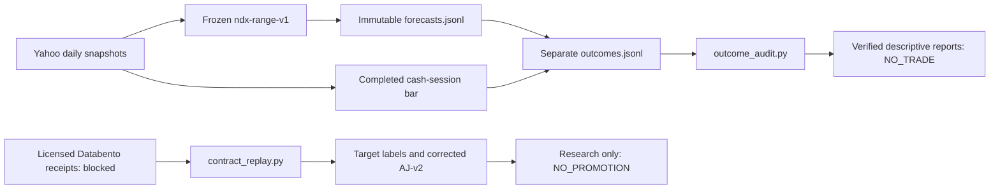

# Phase 3L: verified range evidence and gated futures research

Editable source (no execution connection exists):

- `adapters/snapshots.py` preserves raw/body/normalized evidence. Cache refreshes
  never replace the archived snapshot linked by a forecast or outcome.
- `shadow/outcome_audit.py` verifies source hashes, chronology, reconciliations,
  units, coverage and pinball without writing either journal. Rejected outcomes
  are excluded from the standard forward report's verified metrics.
- `research/contract_replay.py` consumes existing checksum-linked private receipts,
  reuses existing aggregation, VWAP context and target labeling, and does not
  pretend bars contain trade profiles, CVD or depth.
- `research/target_survival.py` now uses event-only AJ survival updates. This is a
  method correction, not a newly fitted or trading-approved model.
- `scripts/run_shadow_task.ps1` still owns refresh/report/monitor execution.
  Interactive tasks require a logged-in user and awake host; unattended-account
  installation and off-host monitoring remain separate deployment work.

The same diagram is in the new Forq frame “Nocturne 3L — evidence and research
gates”; existing workspace elements were not changed.
