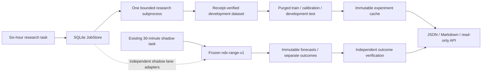

# Phase 3M execution boundaries



The new Forq frame “Nocturne 3M — isolated research and shadow” shows these
separate execution paths; existing elements were not edited.

## Durable state and isolation

- `research/orchestrator.py`: allowlisted job types, immutable specifications per
  idempotency key, same-lane DAG dependencies, SQLite transactions/FULL synchronous
  state, durable transitions, bounded attempts/backoff, restart recovery.
- `research/job_worker.py`: one subprocess per attempt, job/lane identity check,
  independent orphan watchdog, no arbitrary shell commands or broker endpoints.
- Separate OS runner/active locks per lane; training cannot be submitted to shadow
  and research dependencies cannot block inference. A surviving orphan holds the
  lane lock until completion/timeout; completed result recovery never refits it.
- Research uses one numerical thread, lower Windows priority / Unix niceness,
  max attempts 5, max job time 1,800s, configured tick budget up to 3,600s. Defaults:
  20 jobs / 900s plus one independent report up to 60s; task limit 18 minutes.
  Dataset validation currently bounds declared history to 50,000 rows/source.
  This is not a hard RAM quota, cgroup or Windows Job Object memory guarantee.
- `research/jobs.py` reuses shadow scripts, verified daily parsing, grouped
  validation and calibration. Maturity/refresh adapters reuse existing combined
  service cycles; successful jobs do not imply a new forecast or outcome exists.
- `research/daily_experiment.py`: fixed logistic vs frequency protocol, three
  development folds, separate Platt calibration, no hyperparameter search, no
  2024+ scoring. Identical source/data/protocol/code/library identity caches fit
  and evaluation. Saved artifacts/predictions are checksum-checked before reuse.
- Incomplete experiment directories require operator review; do not silently
  delete, overwrite or tune them. Research artifacts never enter the active registry.

## Operation

```powershell
python scripts/phase3m_research.py --lane research
python scripts/phase3m_research.py --lane shadow
python scripts/phase3m_research.py --lane research --no-enqueue
powershell -NoProfile -File scripts/install_research_task.ps1 -WhatIf
```

The research task is deployed separately. Its polling cadence defaults to six
hours; daily enqueue keys prevent duplicate work and experiment identities prevent
repeat fitting on identical frozen data. Shadow buckets are half-hourly and retain
the original issuance deadlines, journal locks and source-quality gates. The
original shadow task remains the deployed inference path; the orchestrator's
shadow adapters were exercised once, not deployed as a second parallel scheduler.

`data/research/orchestrator/` is private/ignored: SQLite, attempts, logs, datasets,
code snapshots and challengers. Back up it and private source snapshots together
under authorized storage. Do not copy a live SQLite file without a consistent
SQLite backup/checkpoint procedure. A repository clone restores code and public
reports, not private experiment or source proof.

Latest public snapshots are `reports/phase3m_jobs.json` and
`reports/phase3m_research.{json,md}`. Immutable report history is in each report
attempt directory, with all transitions retained in SQLite. API GET
`/v1/research/status` reads a timestamped snapshot and marks age over 26h stale;
it never launches jobs. Off-host paging, retention, unattended account setup and
hard resource isolation remain deployment requirements. Sleeping/offline hosts
do not execute work.
