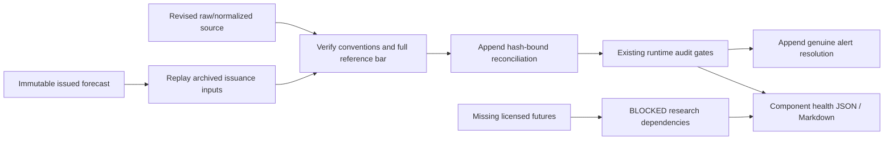

# Phase 3O — recovery is proof, not alert suppression

The same architecture is drawn in the new Forq frame “Nocturne 3O — recovered
core, blocked data”; existing workspace elements were not edited.

- `shadow/reconciliation.py`: existing verifier extended with a deliberate sealed-
  forecast investigation and full revised-bar binding. No prediction/outcome writes.
- `phase3o_reconcile.py`: investigate-only by default, explicit `--apply`, cached
  independent-check evidence and idempotent proof reuse; uses existing archives.
- `shadow/operations.py`: preserves incident semantics while reporting healthy,
  degraded, blocked and failed components separately.
- `research/orchestrator.py`: same persistent runner; explicit DISABLED and
  DEPENDENCY_BLOCKED distinguish lack of permission/data from software failure.
- `research/health.py`: read-only classification of recorded job evidence, not an
  always-on scheduler or new model registry.
- `phase3o_health.py`: fifth stage of the existing shadow runner, with immutable
  private report history and public latest JSON/Markdown. Existing APIs expose job
  and shadow component classifications without starting provider calls or jobs.

The deterministic fixture integration exercises real workers and the existing
data/model pipeline in temporary storage only. Frozen live artifacts, private
market evidence, accounting versions, training/inference isolation, paid-acquisition
approval and NO_TRADE gates remain in their existing paths.

Awake/logged-in Windows host remains required. No password, privilege, security
setting, broker order, frontend or paid cloud resource was introduced.
