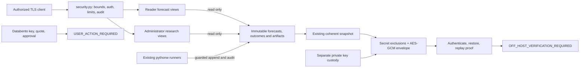

# Phase 3S — security and recovery boundaries

The API never enqueues jobs, changes models, appends outcomes, downloads market
data or places orders. Admin is a view permission, not execution/promotion authority.
Minimal liveness is separate from protected API readiness and operational/model
health. A failed audit sink blocks protected responses. Secret inputs are file-based;
raw values do not enter audit events, Git or recovery archives.

Live scheduling is still the established Windows system. Startup/Password-mode
profiles are available but require operator credentials/approval; existing deployed
principals remain unchanged. Private restore proofs and package hashes do not
validate forecasting skill. Futures, independent samples and production/off-host
acceptance gates remain separate.

Forq architecture frame: **Nocturne 3S — protected reads, private recovery**,
`frame-3a6bcd08-519`. It was created in free space without editing user elements.
Mint indicates local controls; amber indicates external gates. The drawing shows
read request flow, not permission to mutate journals or activate futures trading.
