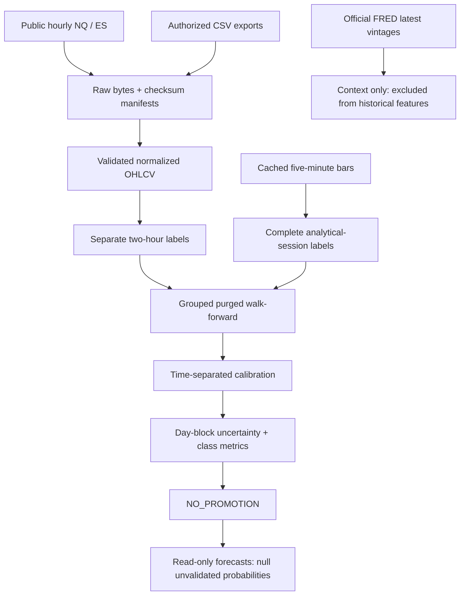

# Architecture Overview

**Status:** backend research platform, not a production trading system.  
**Diagrams:** [`diagrams/01_system_runtime.svg`](diagrams/01_system_runtime.svg),
[`02_prediction_decision_flow.svg`](diagrams/02_prediction_decision_flow.svg),
[`03_research_training.svg`](diagrams/03_research_training.svg).

## Runtime flow

### Phase 3D research flow (current)



The DOT research diagram source is updated for Phase 3D. Existing rendered
SVG/PNG diagrams above are earlier architectural illustrations; Graphviz was
unavailable for regeneration in this environment. This diagram and
`../PHASE3D_FINDINGS.md` describe current implementation and blockers.

```text
Yahoo / Treasury / Fed / calendar
        │
        ▼
adapters/yahoo.py ──► contracts.MarketEvent ──► storage.EventStore (JSONL)
        │                                              │
        │                                              ▼
        │                                   replay(asof) / watermark
        │                                              │
        ▼                                              ▼
auction/ (profile, TPO, IB, AMT) ◄──── bars/trades ────┤
orderflow/ (tape, book, gates) ◄────── optional ───────┤
intermarket/ + premarket.py ◄───────── context ────────┤
        │                                              │
        ▼                                              ▼
strategies/ (ORB, VWAP, value) ──► backtest/engine ──► research/ labels
        │                                              │
        ▼                                              ▼
levels/ (candidate zones)                        ml/ baselines + calibration
        │                                              │
        └──────────────► risk/gates.py ◄───────────────┘
                              │
                              ▼
                 journal/ (append-only predictions)
                              │
                              ▼
                 api/ (read-only FastAPI)
```

## Phase 3B flow

```text
5m bars + prior levels + VIX/ES context
        │
        ▼
research/intraday_features.py (point-in-time)
        │
        ▼
research/target_training.py (signal-grouped split)
        │
        ▼
ml/target_model.py (frequency / logistic / GBM + Platt)
        │
        ├── reports/phase3b_target_model.{json,md}
        │
        ▼
price_levels/engine.py + research/range_model.py + regime.py
        │
        ▼
forecast/v1.py (research-only contract; null probabilities)
        │
        ▼
data/forecasts/NQ_v1.json → GET /v1/forecast/v1
```

The forecast is intentionally `NO_TRADE` while the target model is
`NO_PROMOTION`.

## Phase 3B.3 flow

```text
5m bars + prior levels + ES/VIX context
        │
        ▼
sessions.py (DST-aware snapshots)
        │
        ▼
research/session_dataset.py (next-session labels)
        │
        ▼
ml/session_model.py (direction / consolidation; NO_PROMOTION)
        │
        ├── price_levels/reachability.py (touch probability)
        ├── macro/calendar.py (event risk; no direction)
        ▼
forecast/bundle.py (ASIA/LONDON/NY/NEXT_DAY; NO_TRADE)
        │
        ▼
forecast/evaluation.py (range coverage, target touches, NOT_MATURED)
```

## Component map

| Component | Module | Status |
|---|---|---|
| Canonical contracts | `contracts.py` | Implemented, 6 tests |
| Instrument registry | `instruments.py` | Implemented, 6 tests |
| Session/DST/roll clock | `market_clock.py` | Implemented, 7 tests |
| Immutable event store | `storage/event_store.py` | Implemented, 6 tests |
| Yahoo bar adapter | `adapters/yahoo.py` | Implemented, 2 tests |
| Volume profile / POC / VA | `auction/volume_profile.py` | Implemented, 7 tests |
| TPO profile | `auction/tpo.py` | Implemented, 2 tests |
| IB / opening range / VWAP | `auction/session.py` | Implemented, 4 tests |
| AMT state | `auction/state.py` | Implemented, 4 tests |
| Tape / quotes / CVD | `orderflow/tape.py` | Interfaces implemented; live data blocked |
| Book reconstruction | `orderflow/depth.py` | Implemented, sequence-gap tests |
| Intermarket context | `intermarket/context.py` | Implemented, real ES/NQ/VIX/ZN/ZB proxies |
| Premarket state | `premarket.py` | Implemented, real 2026-11-03 state |
| Strategy specs | `strategies/` | 3 candidates, 6 tests |
| Backtester | `backtest/engine.py` | Implemented, 5 tests |
| Labels / features | `research/` | Implemented, 6 tests |
| Point-in-time intraday features | `research/intraday_features.py` | Implemented, 2 leakage tests |
| Target training / grouped splits | `research/target_training.py` | Implemented, 4 tests |
| Target-first model | `ml/target_model.py` | Implemented; **NO_PROMOTION** |
| Price-level engine | `price_levels/engine.py` | Implemented, 3 tests |
| Expected-range model | `research/range_model.py` | Implemented, 2 tests |
| Regime engine | `regime.py` | Implemented, 2 tests |
| Forecast V1 | `forecast/v1.py` | Implemented, 2 tests |
| Session windows / snapshots | `sessions.py` | Implemented, 5 tests |
| Session dataset | `research/session_dataset.py` | Implemented |
| Session direction models | `ml/session_model.py` | Research; **NO_PROMOTION** |
| Level reachability | `price_levels/reachability.py` | Implemented, 2 tests |
| Macro calendar / critical day | `macro/calendar.py` | Sample schedule only |
| Multi-session bundle | `forecast/bundle.py` | Implemented, 2 tests |
| Forecast evaluation | `forecast/evaluation.py` | Implemented, 2 tests |
| Baselines / calibration | `ml/` | Implemented, 4 tests |
| Risk gates | `risk/gates.py` | Implemented, 6 tests |
| Journal | `journal/store.py` | Implemented, 3 tests |
| Read-only API | `api/` | Implemented, 6 tests |
| Analyst theses | `knowledge/thesis.py` | Implemented, 3 tests |

## Python / TypeScript boundary

- **Python** owns data contracts, replay, auction/profile math, strategies,
  backtests, labels, models, risk, journal and API.
- **TypeScript** (`ts/`) owns the Yahoo fetch helper and zod validation of call
  artifacts. It does not compute features or make trading decisions.
- The boundary is JSON validated on both sides.

## Data gates

The platform distinguishes **available** from **blocked**:

| Data | State | Consequence |
|---|---|---|
| Daily OHLCV (15y) | Available | Research and labels |
| 5m/15m bars (5–60d) | Available | Session structure, ORB backtest |
| True trades by price | **Blocked** | Volume profile is tested with fixtures; bar approximation is labelled |
| Tick/quote/DOM/MBO | **Blocked** | Order-flow features return `UNAVAILABLE` |
| CFE VX futures | **Blocked** | `^VIX` spot is a labelled proxy |
| ZN/ZB futures | Yahoo proxies | Flagged `ZN_ZB_YAHOO_PROXY` |
| Economic calendar | Reference only | Not redistributed; no live event gate yet |

## C++ boundary

The C++20 kernel was built locally with MSVC 19.51 and pybind11 3.1; the parity
test passes. CI builds it on Ubuntu. The Python reference remains the source of
truth; the native path is optional and only used for the profiled aggregation
kernel.

## Safety boundary

There is no broker adapter, no order endpoint, and no TradingView automation.
The API is read-only. `risk/gates.py` can return `NO_TRADE` for stale data,
low coverage, event locks, extreme volatility, expired signals, duplicates, or
negative expected value.
